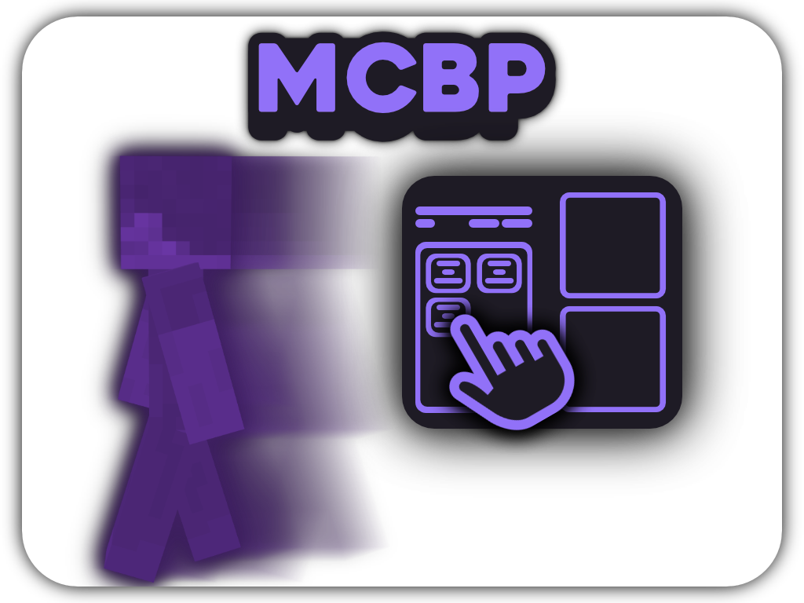

# Minecraft Bot Panel


[](./LICENSE)
[](https://github.com/PrismarineJS/mineflayer)
[](https://github.com/PrismarineJS/mineflayer)
[](https://ancymon.dev/Minecraft-Bot-Panel/)

A desktop app for running Minecraft bots without writing code. Log in, join a server, and then drive the bot yourself, turn on one of the 26 built-in scripts, launch a multi-bot swarm, or ask it to play in chat with a local AI. Built on [Mineflayer](https://github.com/PrismarineJS/mineflayer).



## What it can do

- **Log in your way.** Microsoft accounts work through an in-app window or your browser (the device code gets copied for you), and accounts you've used before are remembered. Offline mode works with any name.
- **Per-server memory & autocomplete.** Remembers your last server, offers inline server-bar autocomplete with one-click removal, and automatically restores the exact modules you had enabled for each server.
- **Drive it yourself.** WASD, jump, sneak and sprint from the keyboard or the on-screen pad. You see HP, hunger, coords and the held item, plus a radar of nearby **players**, **mobs** and **signs**. Signs show their text and have **Click**, **Hit** and **Go** buttons, which is great for joining minigames on lobby servers.
- **Full inventory.** All 46 slots with counts and durability, one-click Auto-Gear, and whatever chest, shop or menu the server opens. You can left, right or shift-click through those just like in game.
- **26 built-in scripts.** Farming, fishing, mining, tunneling, building, chest looting, combat, auto-eat, auto-armor, reconnecting, a **GearUp** module with a dropdown target tier (`Leather`, `Wood`, `Stone`, `Gold`, `Iron`, `Diamond`, `Netherite`), workstation memory (reuses nearby crafting tables & furnaces), 1-block stand-off cave mining with active drop pickup, and a **Survival** mode that plays on its own. Your settings stick between sessions. Full list below.
- **AIChat & AIAgent (Control tab).** Both AI modules live together in the **Control** tab so they stay separate from regular scripts. Hit **Auto-Setup** to install Ollama and a hardware-matched local model (Qwen 3, Gemma 3, Llama, Phi-4 Mini...). **AIChat** replies naturally like a human player — never leaking AI thoughts or robotic phrasing — and splits long replies with natural gaps so anti-spam plugins don't kick it. Nothing goes to the cloud.
- **AI Brain & Autonomous Agent.** Turn on **AIAgent** and players can say "come here", "follow me", "mine 10 oak logs", or "turn on killaura and autoeat". A dedicated **AI Brain** tracks working memory, active multi-step plans, remembered landmarks (spawn, crafting tables, furnaces, chests), recent errors, and Minecraft mechanics. It obeys everyone on the **Allowed Players (`obey`)** list without robotic "Yes sir!" filler, talks only when addressed or contextually invited, and can self-inspect logs, world state, and position to solve problems. Clear orders run straight away via the fast translator, and private reasoning stays in the console only.
- **ViaVersion Compatibility (MC 1.8 ➙ 26.3).** Includes a two-layer ViaVersion engine: runtime protocol shims for **MC 26.2 (protocol 776)** and **MC 26.3 (protocol 777)**, a client `tick_end` packet fix for 1.21.2+/26.3 servers (preventing `invalid_player_movement` kicks), `PartialReadError` shielding, automatic kick-version retry, and an automatic local **ViaProxy** bridge (when Java 17+ is installed) for exact packet translation on 26.2/26.3 servers.
- **NPC & Anti-Cheat FakePlayer protection.** Filters Citizens/lobby NPCs (UUID v2, color-coded/bracketed names, stacked holograms), Watchdog/Matrix orbiting and mid-air killaura check bots, and never mistakes the bot's own username for another player.
- **Never stays stuck.** Whatever is moving the bot (a module, the AI, or you), if it stops making progress it jumps, strafes, re-paths, digs/bridges around obstacles, detects snow/ice setback traps, and backs off to try another route. When AI is active, **AI Fixes Errors** monitors failing modules (including `GearUp`) and repairs them in the background.
- **Built-in Proxy Pool & Multi-Bot Botting.** Connect through SOCKS4/SOCKS5/HTTP proxies with an integrated free-proxy finder, latency auto-tester, and AI auto-heal on failure. Launch and coordinate multiple bots together from the **Botting** tab.
- **Script Studio (Plan ➙ Generate ➙ Verify).** Start from a template, read Mineflayer docs side-by-side, or describe what you want and let your local AI build it. Studio runs an architecture planning pass, generates the script, verifies it in a sandboxed dry-run against a mock bot, and auto-repairs runtime/syntax issues before saving straight into the Scripts tab.
- **Zero-lag Logs & Chat.** Windowed virtual rendering keeps the UI fast even during hours-long sessions. Scroll up to load older entries in real time straight from saved `.md` session logs, and jump back instantly with **Return to Live**.
- **Chat and console.** Server chat with all its colors and formatting, `/commands` with arrow-key history, and `!` bot commands: `!do <commands>`, `!help`, `!pos`, `!hp`, `!gear`, `!gearup [leather|wood|stone|gold|iron|diamond|netherite]`, `!signs`, `!sign <text>`, `!ai <msg>`, `!logs`, `!close`, `!weapon`, `!tool <block>`, `!goto <x> <y> <z>`, `!follow <player>`, `!guard <player>`, `!hunt <player>`, `!stop`, `!dropall`, `!respawn`.
- **Make it yours.** Drop `.js` files into `custom/scripts` and restyle the whole app with `custom/theme.css`.

## Built-in Scripts

| Script            | Options                                                                                         | Description                                                                                                       |
| ----------------- | ----------------------------------------------------------------------------------------------- | ----------------------------------------------------------------------------------------------------------------- |
| **AIAgent**       | `Reply to All Chat`, `Actions Model`, `Allowed Players`, `Allow Code`                           | Lets the local AI run bot actions (move, follow, mine, fight, toggle scripts) with AI Brain planning (Control tab) |
| **AIChat**        | `Reply to All Chat`, `Game State Context`, `Split Long Replies`, `Model`, `Cooldown`, `Persona` | Replies to players in chat like a human player with a local Ollama model and anti-spam pacing (Control tab)       |
| **AntiAFK**       | `Jump`, `Move`, `Rotate`, `Sneak`                                                               | Performs randomized movement actions to prevent idle kicks                                                        |
| **AutoArmor**     | `Repeat`, `Offhand Shield/Totem`                                                                | Equips the highest-tier armor pieces from inventory and keeps a totem or shield in off-hand                       |
| **AutoBuild**     | `Template / File`, `Size [blocks]`                                                              | Builds structures (`platform`, `wall`, `bunker`, `tower`, `bridge`, or `.json` schematic files)                   |
| **AutoEat**       | `Repeat`, `Eat on Low HP`, `Min Food [1-20]`                                                    | Pauses combat to eat high-saturation food when hungry or golden apples when health drops                          |
| **AutoFarm**      | `Replant Seeds`, `Use Bone Meal`, `Collect Drops`, `Radius [blocks]`                            | Harvests mature crops, replants seeds on farmland/soul sand, applies bone meal, and loots drops                   |
| **AutoFish**      | `Auto Equip Rod`, `Anti-AFK Glance`                                                             | Casts a fishing rod toward water and reels in catches automatically                                               |
| **AutoReconnect** | `Resume Scripts`, `Delay [sec]`                                                                 | Automatically rejoins the server after a disconnect or kick and resumes active scripts                            |
| **AutoRespawn**   | `Return to Area`, `Work Area [X Y Z]`                                                           | Automatically respawns upon death and paths back to the work area or death coordinates                            |
| **AutoTool**      | `Mine Tools`, `Combat Weapon`, `Save Durability`                                                | Switches to the fastest harvesting tool when breaking blocks and best weapon in combat                            |
| **AutoTotem**     | `AutoLog Low HP`, `Min HP [1-20]`                                                               | Keeps a Totem of Undying in the off-hand slot and optionally disconnects on critical HP                           |
| **ChestStealer**  | `Steal Supplies`, `Deposit Mined`, `Repeat`, `Filter`                                           | Withdraws supplies from nearby chests/barrels/shulkers or deposits mined resources into storage                   |
| **ClearInv**      | `Repeat`                                                                                        | Drops all stacks from the bot's inventory                                                                         |
| **Excavator**     | `Tunnel Mode`, `Auto Tool`, `Size / Width`, `Length / Depth`                                    | Digs straight tunnels or clears 3D quarry volumes layer by layer using the best tool                              |
| **Follow**        | `Repeat`, `Sprint Jump`, `Pillar / Bridge`, `Player Name`, `Delay`                              | Continuously paths to a target player with sprint-jump and Baritone-style bridging                                |
| **GearUp**        | `Tools & Sword`, `Full Armor`, `Craft Shield`, `Target Loot Tier` (dropdown)                    | Full wood-to-netherite progression with workstation memory, 1-block cave mining, drop pickup, and AI error assist |
| **GoTo**          | `Repeat`, `Dig Obstacles`, `Pillar / Bridge`, `X`, `Y`, `Z`                                     | Paths to world coordinates with optional obstacle digging, pillaring, and bridging                                |
| **Guard**         | `Hostile Mobs`, `Defend PvP`, `Auto Weapon`, `Protect Player`, `Radius`                         | Escorts a target player and attacks threats with jump-criticals and combat eating pauses                          |
| **Hunt**          | `Auto Weapon`, `Sprint Jump`, `Criticals`, `Target Player`                                      | Relentlessly pursues and attacks a target player with sprint-jumps, falling crits, and auto-eat                   |
| **InvManager**    | `Drop Junk`, `Sort & Equip`, `Keep Free Slots`, `Extra Junk`                                    | Keeps inventory clean by dropping junk blocks when slots fill while preserving ores and gear                      |
| **KillAura**      | `Hostile Mobs`, `Players`, `Passive Mobs`, `Auto Weapon`, `Criticals`, `Range`                  | Aims at and attacks real targets within range with jump-criticals while ignoring NPCs and Anti-Cheat fake players |
| **Mine**          | `Repeat`, `Auto Tool`, `Block ID`                                                               | Finds nearby blocks matching `Block ID`, mines from a safe 1-block stand-off, and collects dropped items          |
| **SafeWalk**      | `Sneak at Edges`, `Avoid Lava/Fire`                                                             | Prevents walking off ledges (>1 block drop) or into lava/fire by crouching at block edges                         |
| **Spam**          | `Repeat`, `AntiKick`, `Message`, `Delay [ms]`                                                   | Sends chat messages on a configurable interval with an optional random suffix                                     |
| **Survival**      | `Self Defense`, `Auto Gear & Eat`, `Collect Drops`, `Look Around`                               | Plays autonomously: swims in water, eats, equips gear, blocks creepers, crits attackers, loots                    |

## Plain Commands

The AI Agent and the `!do` console command both understand simple commands and turn them into Mineflayer code for you. Put one per line or split them with `;` or `then`, and they run in order (it waits to arrive before moving on).

```
walk to ancymon            follow me                 stop
walk 100 64 -20            look at ancymon           come here
mine 10 oak_log            attack zombie             attack hostile
eat · gear · hold diamond_sword · drop 5 dirt · drop all
say hello · wait 3s · jump twice · sneak on · forward 2
turn on killaura players=on range=4     turn off killaura
turn on killaura and autoeat            stop all scripts
set spam message hi there               status · logs 20 error · scripts
guard ancymon   hunt ancymon    join kitpvp     use compass     click kitpvp     close     hotbar 3     /server kitpvp
```

Module names are forgiving (`aura`, `auto eat`, `fishing` all work), and so are block names (`oak logs`, `wood`, `diamonds`). The console shows the JavaScript each command became. Lines that are already JavaScript only run when **Allow Code** is on.

## Installation

### Prebuilt releases

Grab the latest build for your system from the [Releases](https://github.com/ancym0n/Minecraft-Bot-Panel/releases) page:

- **Windows**: `MCBPv<version>-win.x64-setup.exe` (installer) or the `.zip`
- **Ubuntu / Debian / Mint / Pop!\_OS**: `MCBPv<version>-linux.amd64.deb`
- **Fedora / openSUSE / RHEL**: `MCBPv<version>-linux.x86_64.rpm`
- **Arch / Manjaro / EndeavourOS**: `MCBPv<version>-linux.x64.pacman` (`sudo pacman -U <file>`)
- **Any other distro**: `Minecraft-Bot-Panel-<version>-x86_64.AppImage` or the `.tar.gz`
- **macOS** (Intel & Apple Silicon): `MCBPv<version>-mac.<arch>.dmg`. The app isn't notarized, so the first time right-click it and pick **Open** (on newer macOS: System Settings → Privacy & Security → **Open Anyway**).

You don't need Node.js for any of these. Mineflayer, Ollama and the docs all get downloaded by the app when it needs them.

Updates are optional and the app asks first. Windows, AppImage, deb, rpm and pacman builds update themselves (Linux packages ask for your password once). On macOS and the zip / tar.gz builds it just downloads the new version or opens the release page for you.

### Running from source

1. Install [Node.js](https://nodejs.org/) (v20+ recommended) and install dependencies:
   ```bash
   npm install
   npm start
   ```
2. Run the automated protocol & ViaVersion test suite:
   ```bash
   npm test
   ```
3. Build packages into `dist/`:
   ```bash
   npm run make        # everything your OS can build
   npm run make:linux  # AppImage, deb, rpm, pacman, tar.gz
   npm run make:win    # setup.exe + zip
   npm run make:mac    # dmg + zip, needs a Mac
   ```
   On Linux `npm run make` builds all the Linux packages plus the Windows installer. rpm needs `rpmbuild` and pacman needs `bsdtar`; if one is missing that package just gets skipped. macOS builds only work on a Mac (Apple's tools don't run anywhere else); there it builds the Mac, Linux and Windows packages.

## Writing your own scripts

The easiest way is the **Studio** tab: pick a template or describe what you want and let your local AI write it, then hit **Save & Load**. If you'd rather do it by hand, click **Folder** in the Scripts tab (or open `custom/scripts/`) and add a `.js` file that exports `info` and `script`:

```js
const info = {
  name: "HelloBot",
  default: { interval: 3000 },
  options: [
    { type: "checkbox", label: "Repeat", id: "repeat" },
    { type: "input", label: "Greeting", id: "greeting" },
  ],
};

async function script(bot, log, clearLog, getOption, scriptRepeater) {
  if (!bot) return log("HelloBot: Connect a bot first");

  async function sendGreeting() {
    const greeting = await getOption("greeting", info.name);
    bot.chat(greeting || "Hello!");
  }

  await sendGreeting();
  if ((await getOption("repeat", info.name)) === "on") {
    await scriptRepeater(sendGreeting, info.default.interval);
  }
}

module.exports = { info, script };
```

### Script API

- `bot`: Active Mineflayer bot instance (`bot.pathfinder` is preloaded on spawn).
- `log(text)`: Logs a timestamped message to the Console Logs panel. Prefixing with `ModuleName: message` formats `ModuleName` as a colored badge.
- `clearLog(matchText)`: Removes existing log rows containing `matchText` so status updates replace cleanly in place.
- `await getOption(id, info.name)`: Reads the current value of an option (`"on"` / `"off"` for checkboxes, or string value for text inputs).
- `await scriptRepeater(fn, intervalMs)`: Runs `fn()` every `intervalMs` while the script remains toggled on and resolves once toggled off.
- `libs`: Runtime libraries `{ goals, Movements, Vec3, mcData }` (6th argument), so scripts don't need to `require` Mineflayer packages.
- Option types: `checkbox`, `input` (optional `placeholder`), and `select` with `choices: ["a", "b"]` or `[{ value, label }]`.

Scripts get full Node.js access, so only run ones you wrote or trust.

## Custom theme

Not a fan of purple? Override the colors (or anything else) in `custom/theme.css`:

```css
:root {
  --bg-dark: #16131f;
  --panel-bg: #1e1a2b;
  --background-color: #9171f8;
  --dark-main-color: #6b4ce6;
  --main-color: #b197fc;
  --light-main-color: #d3c2ff;
  --title-color: #f2edff;
  --accent-dark-bg: #2b2342;
  --accent-dark-hover: #362c54;
  --accent-border: #a488ff;
}
```

## Privacy

No analytics, no accounts, nothing sent to me. Logins, settings, logs and AI models stay on your machine. The full policy is on the [website](https://ancymon.dev/Minecraft-Bot-Panel/privacy).

## License

[GPL-3.0](./LICENSE). Found a bug? [Open an issue](https://github.com/ancym0n/Minecraft-Bot-Panel/issues).
